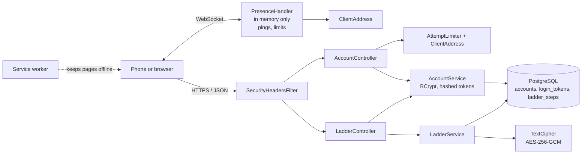

# שכנים – Neighbors

[](https://github.com/barakes/neighbors/actions/workflows/ci.yml)

A quiet place to be together, for people who spend most of their time at home and find it hard to go out.
No chat, no profiles, no likes, no streaks. You see a building at night: every lit window is someone
who is here right now. You can just be there, or do one small thing alongside the others.

**Try it:** https://small-steps-elsi.onrender.com
*(Free hosting: the first visit after a period of inactivity can take up to a minute while the server wakes up.
On a phone, "Add to home screen" installs it like an app.)*

> **Status:** the code is complete for version 1. The wording, the task lists and some product decisions are
> waiting for a review by a mental-health professional before real users are invited. Everything that may
> change after that review lives in one place in the code (`TEXTS` and `GROUPS` in `app.js`, `TEXTS` in
> `ladder.js`, `DEFAULT_STEPS` in `LadderService`).

---

## What it does

**Quiet presence**
- Press **"אני כאן"** ("I'm here") and your window lights up. The server gives you a random window of your own;
  everyone sees the same building, and only your phone knows which window is yours (it has a light frame).
- Pick a small task (drink a glass of water, open a window, step out to the balcony...) and see how many
  neighbors are doing something small at the same moment. Press **"עשיתי"** ("done") and your window glows
  for a moment for everyone.
- The server never learns which task you picked, only that you're doing *something*. A task that isn't marked
  done disappears quietly after 30 minutes: no failure, nothing stored.
- People with a ladder get a fifth group, **"הסולם שלי"**: their own steps as tasks. Doing one together with the
  neighbors also marks it on the ladder. The presence channel still hears only "start": the step never leaves the phone that way.

**A ladder out ("סולם החוצה")**
- A personal ladder of small steps, from inside the room to sitting in a café. Add your own steps, edit,
  reorder or delete them, and mark a step as done.
- A reached step stays reached: a hard day doesn't take it away.
- Needs an account only to keep the ladder. Everything you write is encrypted before it's stored.
- Steps are marked on the ladder only by the person, from the ladder or from its own group: the app doesn't
  guess that "open a window" was the step "open the shutter". Whether to offer that is a question for the professional review.

**Help, always**
- "צריך לדבר עם מישהו עכשיו?" on every screen opens a page with real help lines (emergency numbers, ERAN, SAHAR),
  numbers that dial on tap. It works without signing in, **and without internet**: the app keeps it on the phone.

## Privacy and security

The guiding rule: whatever isn't collected can't leak.

- **Presence lives only in the server's memory.** Who was here, and when, is never written anywhere.
- **Accounts hold a username and a BCrypt password hash.** No email, no phone, no real name.
- **Ladder steps are encrypted with AES-256-GCM** (`TextCipher`) before they reach the database:
  - a new random IV for every text, so the same step never looks the same twice;
  - GCM detects changed bytes instead of decrypting them into garbage;
  - each text is bound to its owner (associated data), so bytes copied into someone else's row won't decrypt;
  - the key comes only from an environment variable, and the server refuses to start without a valid one.
  A test reads the raw bytes from the table and checks that the words don't appear in them.
- **Sign-in tokens are random, and only their SHA-256 hash is stored.** The tables alone can't sign anyone in.
  Tokens expire after 30 days and are cleaned up.
- **Same answer, same time** for an unknown username and a wrong password, so nobody can find out who has an account.
- **Attempt limits:** 10 wrong passwords in 15 minutes, or 5 sign-ups an hour, from one address (a sliding window).
  Once blocked, even the right password waits, so an attacker can't tell which guess was right.
- **The real client address behind the proxy:** Render serves through Cloudflare, so the server itself sees a
  Cloudflare address, and `X-Forwarded-For` can be faked by the client. I tested this on a live server
  with forged headers (in [PlainLetter](https://github.com/barakes/PlainLetter)): `CF-Connecting-IP` is written by
  Cloudflare, and requests that try to send it are refused. The limits count by it (`ClientAddress`).
- **"Delete my account" deletes everything at once**, account, tokens and ladder (`ON DELETE CASCADE`), with no waiting period.
- **Someone else's step answers 404**, exactly like a step that doesn't exist.
- **Text people write is always shown as text** (`textContent`, never `innerHTML`), so it can't run as code.
- **The offline copy never includes API answers**, so one person's ladder can't stay on a shared phone.
- **No third parties:** no analytics, no ads, no external fonts (loading one would tell another company who visits).
- **Security headers on every answer** (`SecurityHeadersFilter`): a strict **Content-Security-Policy** (scripts and
  styles only from this site, as files: no inline scripts at all, so injected code wouldn't run even if it got in),
  `Referrer-Policy: no-referrer` (a help line never learns which app someone came from), `nosniff`,
  no camera/microphone/location, HTTPS only, and no framing by other sites.

## Keeping presence honest

- **No ghost windows.** A phone that sleeps or loses signal often disappears without closing its connection.
  The page sends a small `ping` every 25 seconds; a page silent for 90 seconds is let go and its window goes dark
  for everyone. When the phone wakes, the page reconnects at once and lights its window again (and its task, if it was doing one).
- **No glow storms.** A window glows at most once a minute, however many times someone presses "done".
  Picking another task while already busy changes nothing anyone can see, so it sends nothing.
- **No fake crowds.** At most 10 lit windows and 20 open pages from one address. Not lower on purpose:
  Israeli mobile networks put many unrelated people behind one IPv4 address (CGNAT), and a limit of 2 or 3
  would shut out real people who just happen to use the same carrier.

## Reliability

- **The server doesn't sleep in the evening.** The free plan puts it to sleep after 15 minutes without visitors,
  and waking takes up to a minute: too long for someone opening the app on a hard evening. A scheduled GitHub Action
  (`wake.yml`) visits it every 10 minutes from 17:00 to 01:00 Israel time, when people are most likely to come.
  Not around the clock, because the free hours are shared with my other projects.
- **The help page works offline**, from the copy the service worker keeps on the phone.

## Accessibility and calm

- Your window differs from the others by **a frame, not only a color**; reached steps say so in words.
- The count is also said in words (`aria-live`) for screen readers; the building itself is decorative.
- Big touch targets (44–64 px), visible keyboard focus, and **no animation** for people who asked their phone for less motion.
- Warm wording, no "you haven't been here for 3 days", no points that go down.
- Before a destructive action (deleting the account), the focus goes to "cancel".

## Tech stack

| Area | Technology |
|---|---|
| Language | Java 25 |
| Framework | Spring Boot 4.2 (Web MVC, WebSocket, Data JPA, Validation, Scheduling) |
| Database | PostgreSQL 17 (Neon), Flyway migrations, Hibernate schema validation |
| Security | AES-256-GCM (`javax.crypto`), BCrypt (Spring Security Crypto), SHA-256 hashed tokens |
| Real-time | Raw WebSocket with a tiny protocol (`here`, `start`, `done`) |
| Client | Plain HTML, CSS and JavaScript; an installable web app (manifest + service worker) |
| Tests | JUnit, Mockito, Testcontainers (a real PostgreSQL) |
| CI/CD | GitHub Actions (tests on every push, a scheduled wake-up), Docker (multi-stage, non-root), Render |

## Architecture



Presence never touches the database. The ladder's text is encrypted before it leaves `LadderService`,
so the database only ever sees bytes.

## API

| Method | Path | Description |
|---|---|---|
| `WS` | `/ws/presence` | Send `here`, `start`, `done`, and `ping` every 25 s. Receive `presence` (count, busy, lit windows), `you` (your window), `done` (a window to glow), `tooMany` (too many windows from this address). |
| `POST` | `/api/account/register` | `{"username","password"}` → `201 {"username","token"}`; `400`, `409` name taken, `429` |
| `POST` | `/api/account/login` | `{"username","password"}` → `{"username","token"}`; `401`, `429` |
| `GET` | `/api/account/me` | → `{"username"}`; `401` |
| `POST` | `/api/account/logout` | → `204` |
| `DELETE` | `/api/account` | Deletes the account and everything in it → `204` |
| `GET` | `/api/ladder` | The ladder, bottom step first (the default ladder the first time) |
| `POST` | `/api/ladder` | `{"text"}` → `201`, the new step at the top; up to 20 steps of up to 80 characters |
| `PUT` | `/api/ladder/{id}` | `{"text"}` → the step |
| `DELETE` | `/api/ladder/{id}` | → `204` |
| `POST` | `/api/ladder/{id}/reached` | → the step, reached for good |
| `PUT` | `/api/ladder/order` | `{"ids":[...]}`, every step exactly once → the ladder in its new order |

Every `/api/ladder` and account call (except register and login) needs `Authorization: Bearer <token>`.

## Running it

Needs Java 25, a PostgreSQL database, and these environment variables:

| Variable | What |
|---|---|
| `DB_URL` | `jdbc:postgresql://host/dbname?sslmode=require` |
| `DB_USERNAME`, `DB_PASSWORD` | the database user |
| `LADDER_KEY` | Base64 of 32 random bytes. Keep a copy somewhere safe: without it, saved ladders can't be read. |

A key, in PowerShell:

```
$b = New-Object byte[] 32; [System.Security.Cryptography.RandomNumberGenerator]::Create().GetBytes($b); [Convert]::ToBase64String($b)
```

Then `./gradlew bootRun` and open http://localhost:8080. Flyway creates the tables on the first start.

## Tests

`./gradlew test` (Docker must be running): 79 tests, run by GitHub Actions on every push.

- **Presence:** windows, tasks, the 30-minute timeout (with a clock the test moves forward), who hears what,
  silent pages let go after 90 seconds, pings keeping a page alive, one glow a minute, the per-address limits.
- **Accounts:** unique names regardless of case, Hebrew names, hashes only, the same answer for unknown names and
  wrong passwords, expired tokens, deleting everything.
- **Ladder:** the default ladder, editing and reordering, nobody touching someone else's steps, limits, and
  **the raw database bytes don't contain the text**.
- **Encryption:** round trip, a new IV every time, changed bytes refused, another owner's row refused, another key refused.
- **Limits:** the sliding window, separate addresses, the client address header (for HTTP and for WebSocket).
- **The HTTP API end to end:** real requests through the controllers and the headers filter, checking the
  status codes: 401 without a token, 404 for someone else's step, 400 and 409 on sign-up, 429 after too many
  attempts (and not for another address), and the security headers on API answers.

Database tests run against a real, temporary PostgreSQL in Docker (Testcontainers), never against the production database.

## Limitations

- Free hosting: outside the evening hours the server may sleep and take up to a minute to wake. Presence also starts over after a restart.
- Presence lives in one server's memory, which fits one instance. Several instances would need a shared channel (for example Redis pub/sub).
- The sign-in token is kept in the browser's local storage, which suits an app without user-generated HTML;
  a version with more users would move it to an `HttpOnly` cookie.
- The help lines and their hours were checked in November 2026 and must be checked again before every release.
